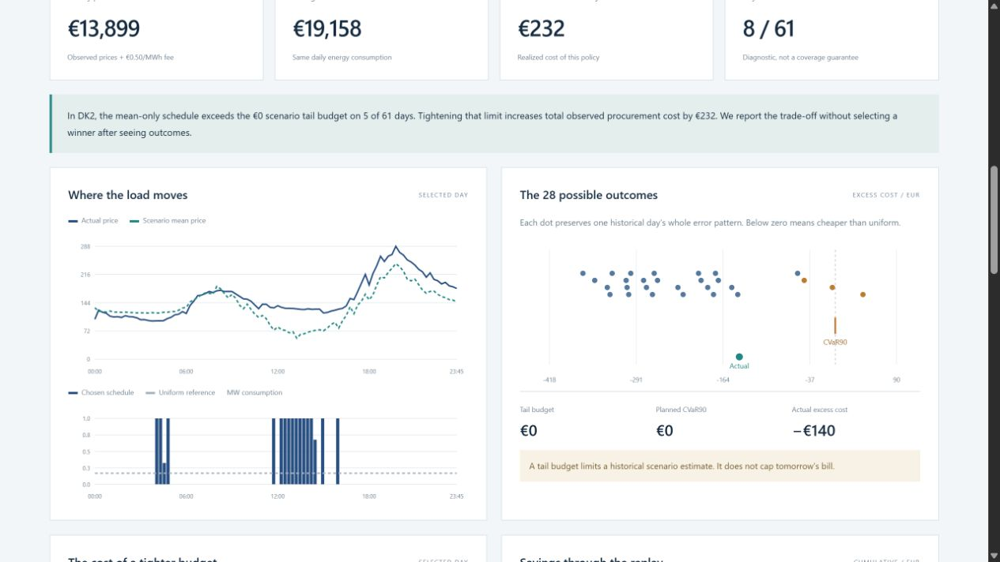

# Harbor — Danish Procurement Risk Lab

[Live interactive preview](https://ehsan-ch.github.io/danish-procurement-risk-lab/) · [Frozen protocol](docs/PROTOCOL.md) · [Results](docs/RESULTS.md) · [Source provenance](docs/DATA.md)

**What does caution cost?** Harbor schedules a hypothetical flexible electricity load using forecast-error scenarios and a limit on estimated tail cost. It compares those estimates with later observed costs, rather than presenting a risk budget as a guaranteed loss limit.



The new work is scenario construction, conditional-value-at-risk (CVaR) constrained optimization, chronological evaluation and auditable accounting. Price forecasts are transparently reused from [Nordcast](https://github.com/Ehsan-Ch/danish-power-forecast-lab), with its original choices retained: ridge for DK1 and boosted median for DK2.

## Findings

Replay: 1 August–30 September 2026, **61 days per area**, after a July residual-history warm-up. The fully interruptible load consumes **4 MWh/day**, with maximum **1 MW** power.

| Policy | DK1 observed cost | DK2 observed cost |
|---|---:|---:|
| €0 scenario tail budget | €12,499.79 | €13,899.35 |
| €25 scenario tail budget | €12,499.79 | €13,777.20 |
| €100 scenario tail budget | €12,499.79 | €13,667.39 |
| Mean cost only | €12,499.79 | €13,667.39 |
| Uniform demand | €32,562.43 | €33,057.61 |

In DK1 the risk constraints leave every mean-cost schedule unchanged. In DK2 the €0 limit changes five days and adds **€231.96** to observed cost relative to the unconstrained policy. The €25 limit adds **€109.81**. This short, favorable sample does not establish a universally better policy.

All optimized policies are cheaper than uniform on every observed day. Yet daily excess cost exceeds its estimated VaR90 on **7/61 days in DK1** and **8/61 in DK2**. A model can save money while its risk estimates remain imperfect. No nominal coverage guarantee is claimed, particularly because the same small scenario sample is used for optimization and risk estimation.

## Model

At 10:00 Copenhagen time on D−1, select the most recent 28 complete error days available under a delivery-end-plus-24-hour delay. Each scenario is the target forecast plus one entire historical vector of actual-minus-forecast errors. Quarter-hour dependence within each vector is preserved; all scenarios have equal probability.

For quantities q and uniform reference u, scenario excess cost is `L_s = price_s · (q − u)`. Positive means more expensive than uniform. Minimize scenario mean cost subject to:

```text
sum(q) = 4 MWh
0 <= q[t] <= 0.25 MWh
eta + sum(z[s]) / (28 * 0.10) <= daily budget
z[s] >= L_s - eta
z[s] >= 0, eta unrestricted
```

CVaR90 averages the worst 10% probability mass: two full scenarios and 0.8 of the next, not just three rounded observations. A constant €0.50/MWh fee adds €2/day to every policy. Negative prices are retained. Each accepted HiGHS solution is independently checked against energy, power and empirical tail constraints.

## Run and reproduce

Python 3.11 or 3.12, from the repository root:

```sh
python -m venv .venv
# Windows: .venv\Scripts\activate
# macOS/Linux: source .venv/bin/activate
python -m pip install -e .
python -m harbor.cli serve --port 8793
```

Open http://127.0.0.1:8793/. The public preview is static and needs no API key or backend. Use HTTP rather than opening the HTML as a local file.

```sh
python -m harbor.cli replay --output reports/custom
python -m unittest discover -s tests -v
node --test tests/core.test.mjs
```

The pinned forecast archive is included, so reproducing the replay needs no API download or forecast training. It takes seconds on the development machine. LP solvers may choose different schedules when objectives tie; compare feasibility and objective values across versions. The replay stops on a non-optimal solve or invalid schedule.

## Explore and audit

- Area, policy and date controls; a shortcut to the first DK2 day whose mean-only estimated CVaR exceeds €25. This is selected by planned risk, not realized profit.
- Actual and scenario-mean prices, planned load, all 28 scenario excess costs, realized outcome and estimated CVaR.
- Daily and full-period comparisons; cumulative savings; explicit assumption notes.
- Every residual source date and availability timestamp; complete quarter-hour journal and CSV exports.

| File | Contents |
|---|---|
| `harbor/risk.py` | Fractional-tail risk, LP optimizer and cost accounting |
| `harbor/scenarios.py` | Eligibility filter and whole-day residual scenarios |
| `harbor/source.py` | Pinned Nordcast import, UTC and data validation |
| `harbor/pipeline.py` | Chronological replay and reports |
| `reports/results.json` | All schedules, scenario outcomes, lineage, versions and protocol hash |
| `reports/daily.csv` | 610 policy-day records |
| `reports/intervals.csv.gz` | 58,560 full-precision quarter-hour records |

**20 Python and 6 JavaScript tests** cover fractional-tail math, analytic schedules, active risk constraints, monotonic expected cost as budgets relax, input rejection, solver failure, future-price isolation, chronological lineage, source integrity, accounting and browser exports. GitHub Actions runs Python 3.11/3.12 and Node 22.

## Limits

This is retrospective research on data already examined in earlier projects, not independent fresh forecast validation. Historical residuals may span monthly model updates. Twenty-eight scenarios are too few to characterize rare risks reliably; there is no volatility, weekday or regime adjustment. Optimization and risk assessment share the same paths.

The load is continuously adjustable and fully interruptible. No ramps, contiguous-run requirements, tariffs, taxes, imbalance costs, partial fills or actual market bids are modeled. Commitment before clearing-price knowledge is hypothetical; scheduling after publication uses a different information set. Prices may be revised. DST functions are tested, but scenario replay rejects unequal local-day lengths instead of inventing alignment.

Code is MIT. Energinet-derived data/results retain CC BY 4.0 attribution; see [DATA.md](docs/DATA.md). No live trading or investment-return claims.
